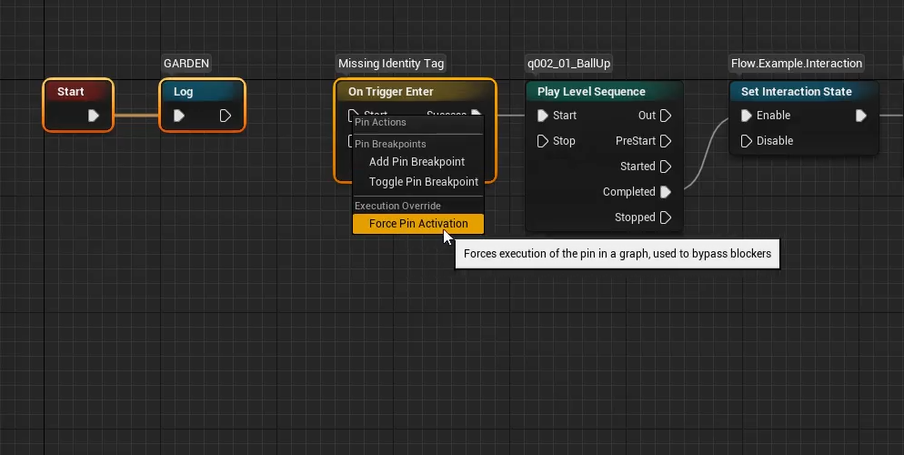

Force Pin Activation pushes the graph execution past a blocker. If a specific node doesn't work for whatever reason, you can trigger its pin manually and continue playtesting.

## Usage

* Start PIE, open a Flow Asset and select its instance in the debugger.
* Right-click a pin and choose **Force Pin Activation** from the **Execution Override** section. The option is available only during PIE.
* The pin is triggered on the node of the selected instance.

## Input and output pins

* **Input pin** - the node activates and executes this input, as if the signal arrived through a connection. This works on unconnected input pins too.
* **Output pin** - the signal goes to the connected node. The node triggering the output stays active. Outputs of a node that already finished can't be triggered.

Forced activations are recorded like regular ones and marked as "forced activation" in the pin tooltip, so you can tell them apart while inspecting the graph.

Nodes run in the PIE world, so actors spawned by forced pins appear in the game, not in the editor world.

## Related

Force Pin Activation pushes a single pin. To push the game along the whole route from the currently active node to a node further in the graph, use [Fast Forward](FastForward.html).
