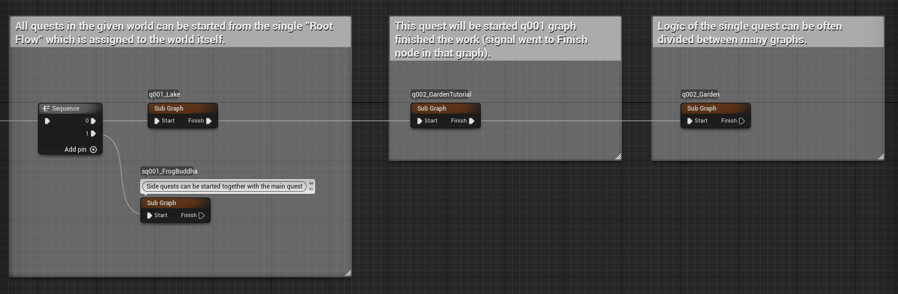
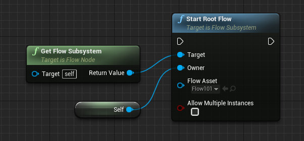
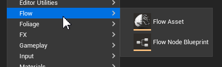

## How to separate the logic between many graphs?
The basic and recommended way is to use the `Sub Graph` node to start graph B from graph A. This way we could have very complex logic, i.e. separate graphs for every quest or event. 

## Is it possible to have a Flow Graph independent from the world?
Yes, it's an everyday use case, i.e. if you want to have a global "meta-quest" (controlling the game's story) or graph that is tracking achievements. You can create a Flow Asset instance from anywhere in the game by calling `UFlowSubsystem::StartRootFlow`.

## My Flow Node blueprint isn't visible in the Palette?
This happens if a given blueprint was created with a standard blueprint creation menu. You have to create blueprint nodes via a dedicated Content Browser menu item. (Similar inconvenience applies to creating Editor Blutilities, which won't run if created via the standard blueprint menu).

