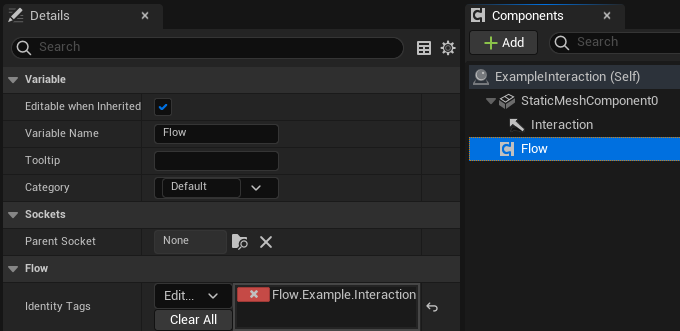
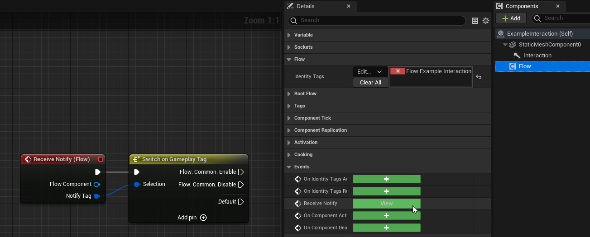
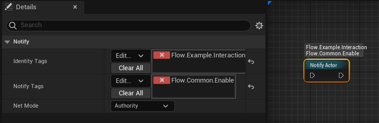
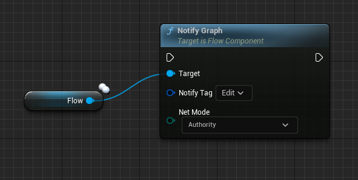
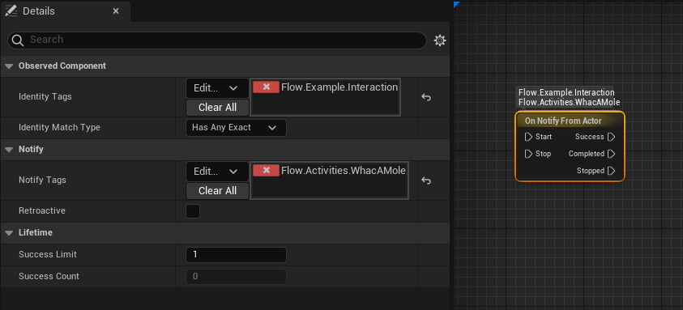
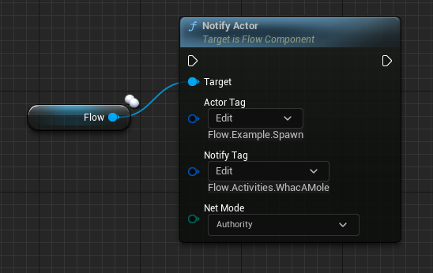
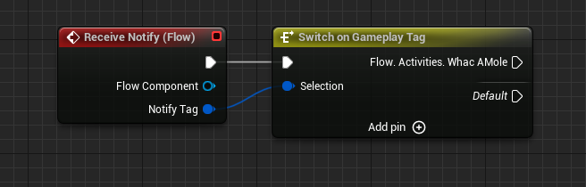
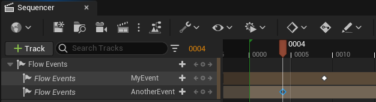
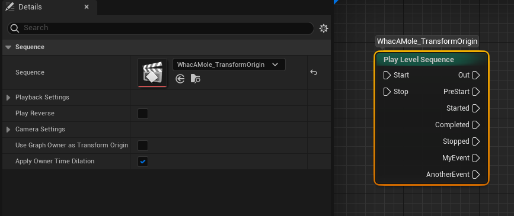
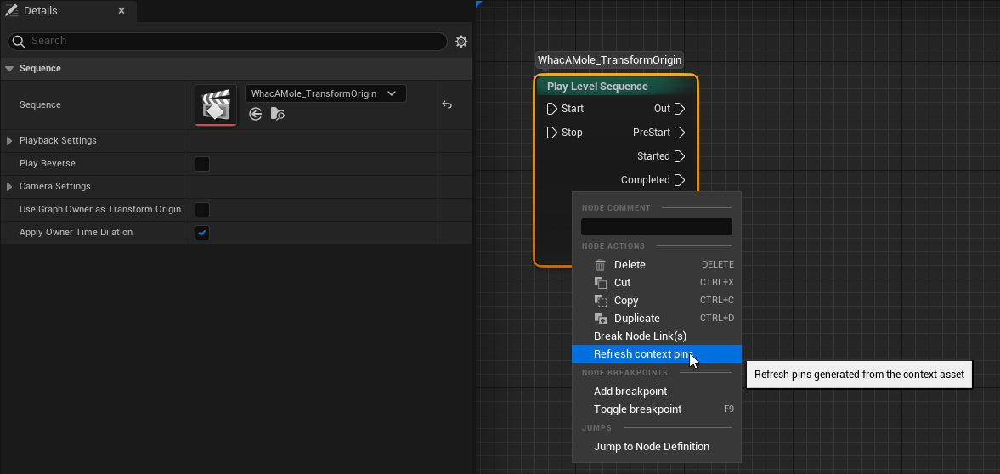

Nodes available in the Flow plugin support finding actors and communicating with them by Gameplay Tags. 
- This can have many advantages over using soft references to actor instances, i.e. changing actor instance name won't break reference.
- This also allows communicating with actors spawned in runtime, i.e. all characters.
- You can call multiple actors identified by the same Gameplay Tag, which may be useful in many cases.

Obviously, you can use soft references to actors in your project-specific Flow nodes. Although the Flow plugin comes with a mechanism to call events in a generic way, without the need to know the actor's class and functions.

## Adding Flow Component to Actor

* Add `Flow Component` to the actor.
* Assign a unique gameplay tag on the `Identity Tags` list.

## Calling Actor events from the Flow Graph

* Add the `Receive Notify` event from the Flow Component.

* Place the `Notify Actor` node in your Flow Graph.
  * `Identity Tags` should include the Identity Tag assigned in the Flow Component. `Match Type` and `Exact Match` decide how these tags are compared with Identity Tags of components.
  * `Notify Tags` are sent through the `Receive Notify` event to your actor, one event per tag. It allows you to call different events in the same actor. Without any Notify Tag, nothing is sent.
  * `Net Mode` decides where the notify is sent, i.e. only on the server.

## Calling Flow Graph event from the Actor

* Call `Notify Graph` from the Flow Component. It requires a valid Notify Tag, otherwise nothing is sent. `Bulk Notify Graph` sends multiple tags at once.

* Place the `On Notify From Actor` node in your Flow Graph.
  * `Identity Tags` should include the Identity Tag assigned in the Flow Component.
  * `Notify Tags` are optional. If added, the tag sent by Notify Graph needs to match one of them. Otherwise, the `Success` output won't be triggered. Disable `Exact Match` to accept child tags too.
  * If `Notify Tags` are empty, the node won't check what tag has been sent from the actor. The `Success` output will always be triggered.
  * Enable `Retroactive` to also react to a notify sent just before the node started observing. It's useful in multiplayer, where a client-side node may start after the server already sent the notify.
  * `Success Limit` decides after how many notifies the node completes. Set it to zero to receive notifies until the node is stopped.

## Calling events between Actors

* Source Actor: call `Notify Actor` from the Flow Component.
  * `Actor Tag` is the Identity Tag of target actors. All actors with this tag receive the notify.
  * `Notify Tag` is required. It allows you to call different events in the target actor.

* Target Actor: add the `Receive Notify` event from the Flow Component.

## Calling Flow Graph events from Sequencer

* Add the `Flow Events` track to the Level Sequence.
  * Simply place a key on the section and give it a name.

* Include this Level Sequence on any `Play Level Sequence` node.
  * Either use the `Refresh` button on the Flow Asset editor toolbar or the `Reconstruct node` option in the node's context menu. You need to use it after every change of event names, adding or removing events from the timeline.

