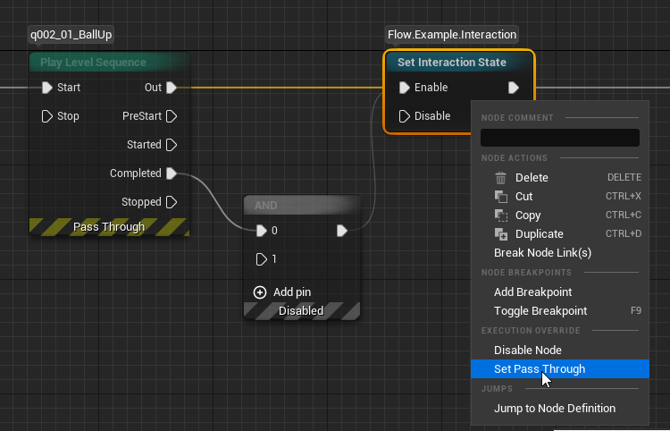

The Signal Modes concept was born from the need to support patching already released games. Flow Graphs serialize the state of their active nodes to a SaveGame. This works well, but there's one inherent limitation. If a player has a SaveGame with a given Flow Node active and serialized to a SaveGame, we cannot remove this node from the graph post-launch. Hence, we shouldn't remove any node post-launch to be perfectly safe.

## Basics

Yet we sometimes need to change the logic of our game in patches. Signal Modes provide a solution for that. It allows designers to mark nodes as:
* **Enabled** - Default state, node is fully executed.
* **Disabled** - No logic executed, any Input Pin activation is ignored. The node doesn't activate, so the signal stops there.
* **PassThrough** - Internal node logic not executed. All connected outputs are triggered, node finishes its work.

This way, we can deactivate nodes without removing them from the graph, so we can properly continue graph execution from a legacy SaveGame. Pin connections aren't serialized to a SaveGame, so we can safely change connections on pass-through nodes any way we need.

Signal Mode is set from the node's context menu, in the **Execution Override** section. It can't be changed during PIE.

By default, a note is logged every time a disabled node ignores its input or a pass-through node passes the signal. You can turn it off in Project Settings, in the Flow section, with `Log On Signal Disabled` and `Log On Signal Passthrough`.

## Allowed Signal Modes

The node author can limit the list of available signal modes for a given Flow Node class.
Some nodes are already acting like pass-through nodes by design, like Reroute or Sequence. It would be redundant or confusing to mark them as PassThrough, so we removed that from the list of available signal modes.

`AllowedSignalModes = {EFlowSignalMode::Enabled, EFlowSignalMode::Disabled};`
